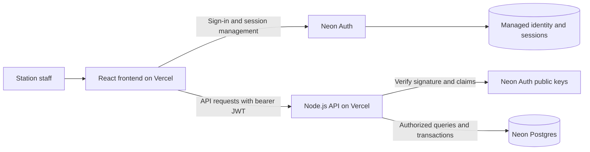

# Architecture

LogronoWaters manages one water refilling station. The system consists of a React single-page application, an authenticated Node.js API, Neon Postgres, and managed Neon Auth.

## System overview

Vercel serves the frontend and its API under the same application origin. The browser communicates with managed Neon Auth for identity and with the application API for station data. Postgres credentials are available only to server-side code and migration tooling.

## Components

| Component         | Responsibility                                                                    |
| ----------------- | --------------------------------------------------------------------------------- |
| React frontend    | Navigation, forms, charts, tables, filtering, exports, and print views            |
| API boundary      | Authentication, role checks, input validation, response handling, and request IDs |
| Business services | Order transitions, price calculation, stock operations, and reporting             |
| Postgres          | Durable records, relational constraints, transactions, and migration history      |
| Managed Auth      | Account registration, email verification, sign-in, recovery, and sessions         |

The frontend requests data on page loads and after relevant actions. Dashboard figures are calculated from saved records. Notifications surface low stock and due maintenance.

## Data model

| Record            | Purpose and relationships                                                                                              |
| ----------------- | ---------------------------------------------------------------------------------------------------------------------- |
| Station settings  | One station's business details, prices, and reporting timezone                                                         |
| Customers         | Contact details and addresses; referenced by orders and retained when archived                                         |
| Orders            | Customer reference, historical name/address, quantities, original pricing, fulfillment, status, and payment state      |
| Inventory         | Quantities and reorder thresholds for filled containers, empty containers, and caps/seals; optional supplier reference |
| Suppliers         | Contact details for inventory suppliers                                                                                |
| Stock operations  | Unique request identity and actor for stock adjustments or refill production                                           |
| Stock movements   | Quantity change, resulting balance, reason, actor, and related order or operation                                      |
| Maintenance       | Equipment tasks, due dates, and completion state                                                                       |
| Migration history | Applied schema versions, checksums, and timestamps                                                                     |

Neon manages identity tables separately from the application schema. Station migrations do not create or modify the managed Auth schema.

## Authentication and authorization

The API verifies each bearer token against the branch's Neon Auth public keys, checking its signature, issuer, audience, and expiry. Access also requires a verified email, an account that is not banned, and membership in an approved administrator or staff email list.

Administrator permissions cover station settings, supplier changes, stock alert configuration, customer archival/restoration, and payment reversals. Staff permissions cover daily operations. Authorization is enforced by the API independently of visible frontend controls.

API responses containing business data are not cached. Error responses carry a request ID; server logs record the request ID and error code without logging customer data, tokens, or SQL parameters.

## Consistency and historical accuracy

Order creation calculates prices on the server and reserves filled containers in the same transaction. Cancellation restores reserved stock once. Refill production consumes empty containers and caps and adds filled containers as one transaction. A shortage rolls back the complete operation.

Conditional stock updates and database locks protect concurrent writes. Unique request IDs make order creation and stock operations safe to retry without applying stock changes twice. Database constraints reject negative inventory and invalid record states.

Orders preserve the customer name, delivery address, and prices recorded at creation. Currency values use integer centavos. Timestamps are stored with timezone information, and reporting uses the station's selected timezone.

## Deployment boundaries

The frontend is a Vite build served by Vercel. Application API routes run as Node.js Vercel Functions with Fluid compute. A shared Postgres connection pool is attached to Vercel's lifecycle management and uses the pooled Neon connection string.

Migrations use a separate direct connection and run outside the frontend build. Development, preview, and production environments use their intended Neon branches and matching Auth configuration. See [Deployment](DEPLOYMENT.md) for configuration and recovery procedures.

## Repository map

| Location             | Responsibility                                                              |
| -------------------- | --------------------------------------------------------------------------- |
| `src/pages/`         | Dashboard, orders, inventory, customers, settings, and account screens      |
| `src/components/`    | Shared layout and interface components                                      |
| `src/lib/`           | Browser Auth/API clients, station context, and data hooks                   |
| `api/`               | Vercel function entry point                                                 |
| `server/`            | Authentication, validation, routing, business services, and database access |
| `db/migrations/`     | Versioned station schema                                                    |
| `scripts/`           | Local API server and migration tooling                                      |
| `tests/`             | Database/API coverage and browser workflows                                 |
| `.github/workflows/` | Continuous integration                                                      |

For product behavior and operational limits, see [Project details](PROJECT.md).
